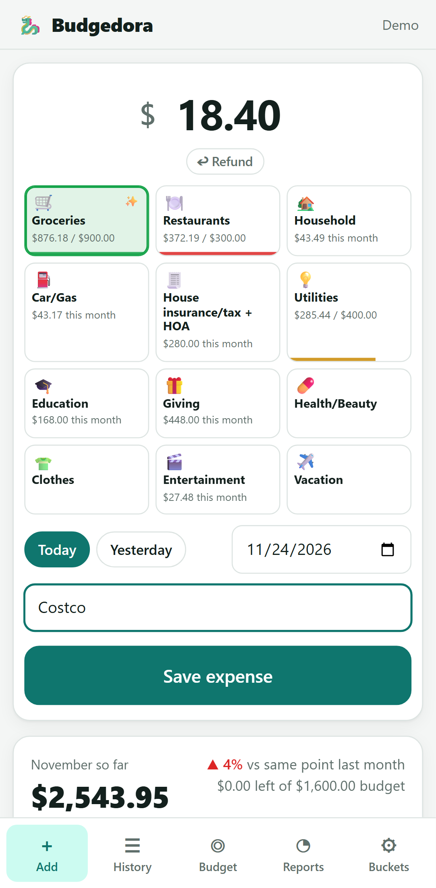
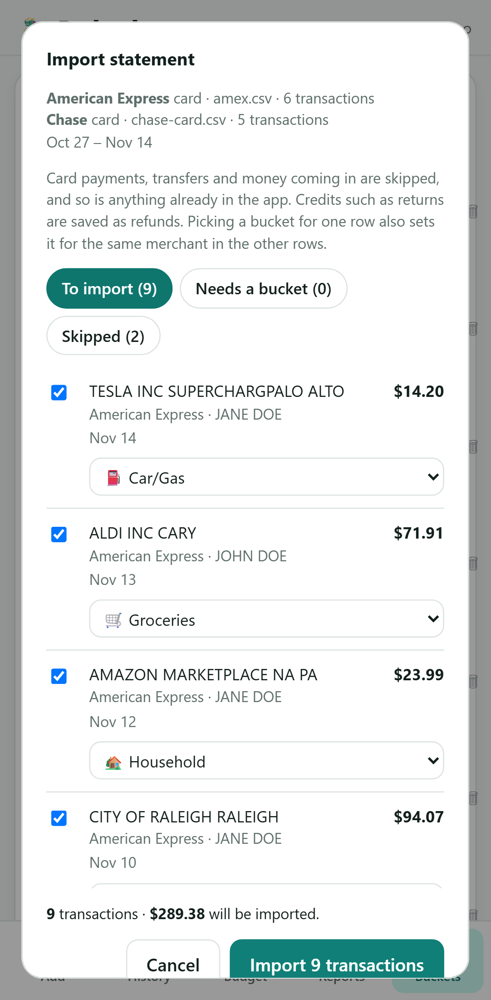
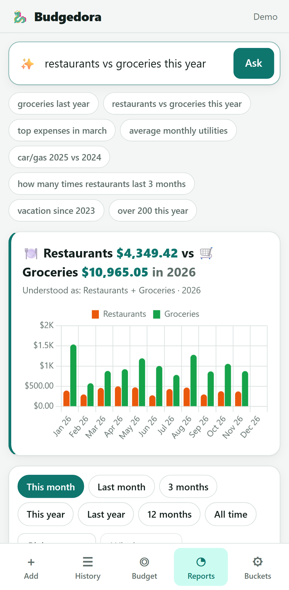
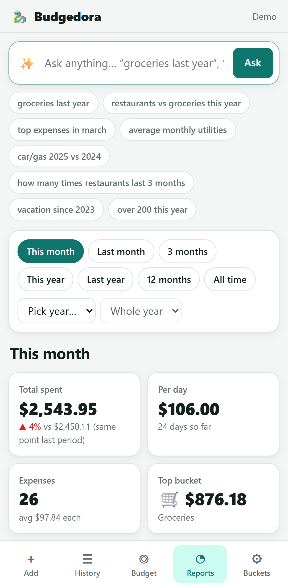

# 🐉 Budgedora

[](https://github.com/gh1d0ra/budgedora/actions/workflows/ci.yml)


A super simple, multi-account expense tracker. Type an amount, tap a bucket, done.
**Live:** https://budgedora.igorrash.workers.dev

| Add | Import a statement | Ask a question | Reports |
|---|---|---|---|
|  |  |  |  |

## How it's built

- **Serverless:** a TypeScript API on **Cloudflare Workers**, with **D1** (SQLite) for data, **KV** for backups and a **cron trigger** for daily snapshots.
- **One API, two runtimes:** the API is a pure `(Request, Db) → Response` function. It runs on Workers in production and on Node's
  built-in `node:sqlite` locally and in tests, through a four-method DB adapter.
- **Private statement import:** bank PDFs, CSVs and Amazon order history are parsed **in the browser** (self-hosted pdf.js).
  Only the rows you approve reach the server.
- **Security:** PBKDF2 passwords, lockout and per-IP throttling, HttpOnly sessions, a JSON-only CSRF guard, and a strict CSP with no `eval`.
- **Tested and shipped by CI:**
  - 57 unit and API tests (`node:test`) and Playwright browser tests on desktop and phone sizes;
  - GitHub Actions runs the type check, tests and a Worker build on every push, then deploys `main`.
- **No front-end framework:** vanilla JS with no build step. Server-side TypeScript runs directly on Node 22.18+ by stripping the types.

Read more: [architecture overview](docs/architecture.md) (diagrams, data model, request flow) and
[design decisions](docs/decisions/).

Inspired by the best parts of YNAB / Goodbudget (envelope-style **buckets** with optional monthly budgets),
Monarch / Copilot (clean reports, month-to-date pace) — minus the bank syncing and complexity.

## Features

**Fast entry**
- Big amount field with math (`45.20+12` → $57.20)
- One-tap bucket grid showing this month's spend and budget bar per bucket
- Today / Yesterday chips or any date
- ✨ Auto-picks the bucket from your note (learns from your history: “Costco” → Groceries)
- ✨ Typing an amount you've used before (e.g. 15.49) offers “Netflix · Entertainment” in one tap
- Undo after every save

**Reports** (any period: this/last month, 3/12 months, this/last year, any year or month, all time)
- KPIs with a fair “vs same point last period” comparison
- ✨ Insights: month-end projection, biggest movers, over-budget alerts, unusual expenses, recurring charges
- Donut by bucket, monthly stacked bars, cumulative month-vs-last-month line
- Year-over-year chart, **years × months** heatmap (click to drill in), **buckets × months** grid
- Biggest expenses, spending by weekday

**Ask in plain English** — e.g.
`groceries last year` · `restaurants vs groceries 2025` · `car/gas 2025 vs 2024` · `top expenses in march` ·
`average monthly utilities` · `how many times restaurants last 3 months` · `netflix` · `costco since 2024` · `over 200 this year` · `q2 2025`

**Accounts** — each login has its own buckets and data (PBKDF2-hashed passwords, HttpOnly session cookies).
Default buckets: Groceries, Restaurants, Household, Car/Gas, House insurance/tax + HOA, Utilities,
Education, Giving, Health/Beauty, Clothes, Entertainment, Vacation. Rename, recolor, reorder, budget or archive any of them.

**Budget** — set an *expected* amount per bucket for every month (default) and override any single month
(e.g. Vacation in July). See expected vs actual with **Remaining** and **Over budget** per bucket and in total,
copy last month's plan, and a year table (Expected · Actual · Over budget · Remaining · Net) like a yearly budget sheet.

**Refunds** — negative amounts (or the ↩ Refund toggle) subtract from a bucket.

**Data** — import **bank / card statements**: American Express (CSV or Excel), Chase and Wells Fargo (CSV, card or checking),
or their PDF statements (read in the browser with a self-hosted pdf.js), or any bank's CSV / QFX / OFX — several files at once. Card payments, transfers and income are skipped, re-imported
transactions are detected, and buckets are guessed from your history, merchant names and the bank's category; you review
every row before saving. Also import your **Excel budget** (one sheet per month, one column per category; read in the browser and
reviewed before saving), CSV export/import (`date,bucket,amount,note`).

## Security

- Passwords: PBKDF2-SHA256 (100k iterations), constant-time compare, same timing for unknown emails.
- Account lockout: 5 wrong passwords in a row → locked 15 min, doubling on each further miss (max 24 h); reset on success.
  Plus 30 attempts / 15 min per IP across all accounts.
- Sessions: random 256-bit tokens in HttpOnly, SameSite=Lax, Secure cookies; 60 days; password change/reset signs out other devices.
- CSRF: state-changing requests must be JSON. XSS: all user text is escaped; strict Content-Security-Policy (no inline scripts, no eval),
  plus X-Frame-Options, nosniff, HSTS, no-referrer, Permissions-Policy.
- Password reset: the family admin creates a one-time link (24 h, only its hash is stored). Admins are listed in the
  `ADMIN_EMAILS` Cloudflare secret (`npx wrangler secret put ADMIN_EMAILS`), so no email address is kept in the repo.
- Account deletion: 3-step confirmation; soft delete — the account is hidden and signed out, all data kept; the admin can restore it.
- The admin panel shows account names, status and counts — never anyone's expenses.

## Backups

1. **Cloudflare D1 Time Travel** — point-in-time restore of the whole database (built in).
2. **Daily snapshots in KV** (cron 04:17 UTC): `daily/…` kept 35 days, `monthly/…` forever; admin "Back up now" → `manual/…` kept 180 days.
3. **Weekly export to this PC** — `scripts/install-backup-task.ps1` registers a Windows task (Sundays 8 PM) running
   `scripts/backup-local.ps1` → `DocumentsBudgedora Backupsudgedora-YYYY-MM-DD.sql` (newest 52 kept).

Restore from a snapshot (upserts; `--user` restores just one account):

```bash
wrangler kv key list --binding BACKUPS --remote
wrangler kv key get --binding BACKUPS "daily/2026-11-24.json.gz" --remote > snap.json.gz
node scripts/snapshot-to-sql.ts snap.json.gz restore.sql [--user someone@example.com]
wrangler d1 execute budgedora --remote --file=restore.sql
```

## Run it

Requires **Node.js 22.18+** for local runs: Node runs the TypeScript files directly and has SQLite built in, so no `npm install` or build step is needed to run it.

```bash
npm start            # http://localhost:3000
npm run seed         # optional: demo account demo@budgedora.test / demo1234 with 3 years of data
```

The server side (`server.ts`, `src/*.ts`, `scripts/*.ts`) is **TypeScript**; the browser code in `public/` is plain JavaScript.

## Tests

```bash
npm install            # once: dev tools only (TypeScript, Playwright)
npm run check          # type-check the Node side and the Worker side
npm test               # unit + API tests (node:test, in-memory SQLite) — a few seconds
npx playwright install chromium   # once
npm run test:e2e       # browser tests: desktop + phone, against a throw-away local server
```

| Suite | What it covers |
|---|---|
| `test/statements.test.ts` | AMEX / Chase / Wells Fargo CSV, OFX and PDF parsing, year rollover, totals check, skip rules, bucket guesses, duplicates, Amazon matching |
| `test/smart.test.ts` | plain-English questions, periods, the amount calculator, suggestions, recurring charges |
| `test/api.test.ts` | sign-up and sessions, lockout and IP throttling, CSRF guard, isolation between accounts, CRUD, import and export, admin reset and restore, snapshots |
| `e2e/app.spec.ts` | sign up → add an expense → import an AMEX statement → ask a question, in Chromium (desktop and Pixel 7) |

All fixtures are made up; no real statements are stored in the repo.

**CI/CD:** [`.github/workflows/ci.yml`](.github/workflows/ci.yml) runs on every push and pull request:
- the type check and unit tests on Node 22 and 24;
- a Worker bundle check;
- the Playwright tests.

On `main` it then deploys to Cloudflare with `wrangler`. That step needs the `CLOUDFLARE_API_TOKEN` and
`CLOUDFLARE_ACCOUNT_ID` repository secrets, and is skipped with a notice until they're added.

Environment variables: `PORT` (default 3000), `DATA_DIR` (default `./data`, where `budgedora.db` lives).

## Production: Cloudflare Workers + D1

Live at **https://budgedora.igorrash.workers.dev** (free tier is plenty for a family).

```bash
npm i -g wrangler && wrangler login      # once
wrangler d1 create budgedora             # once — put the id in wrangler.toml
npm run cf:db:init                       # once — creates the tables (safe to re-run)
wrangler kv namespace create budgedora-backups   # once — put the id in wrangler.toml
wrangler secret put ADMIN_EMAILS            # once — family admin email(s), comma-separated
npm run deploy                           # every update
```

Add a demo account with ~3 years of made-up expenses to the live site (re-running resets it):

```bash
node scripts/demo-sql.ts someone@example.com theirpassword "Name" demo.sql
wrangler d1 execute budgedora --remote --file=demo.sql
```

Upgrading an older database: run each new file in `src/migrations/` once with `wrangler d1 execute budgedora --remote --file=…`.

## Structure

```
src/api.ts           the JSON API (shared by Workers and Node) and its types
src/worker.ts        Cloudflare Worker entry (D1 + static assets)
src/sqlite-db.ts     node:sqlite version of the DB adapter (local server + tests)
src/schema.sql       database schema (fresh installs)
src/migrations/      schema changes for existing databases
server.ts            local Node server (node:sqlite)
wrangler.toml        Cloudflare config
tsconfig*.json       type checking (Node side, Worker side)
test/                unit + API tests and made-up fixtures
e2e/                 Playwright browser tests (playwright.config.ts)
docs/                architecture, decision records, screenshots
.github/             CI/CD workflow and Dependabot
public/index.html    the single-page app
public/app.js        UI (entry, history, reports, settings)
public/smart.js      periods, natural-language questions, insights, suggestions
public/statements.js bank / card statement and Amazon order parsing
public/app.css       styles (light + dark)
scripts/seed-demo.ts local demo data
scripts/demo-sql.ts  demo account for the live database
scripts/backup-*.ps1 weekly local backup + task installer
scripts/snapshot-to-sql.ts  restore a KV snapshot
```
