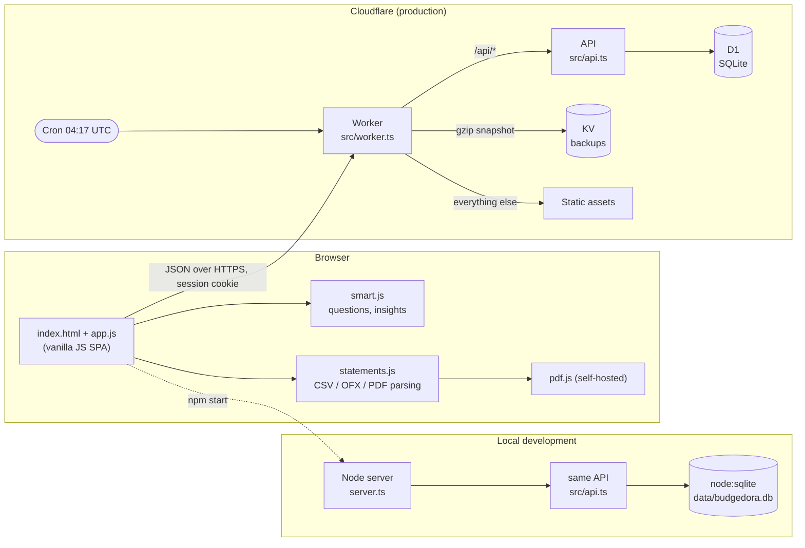
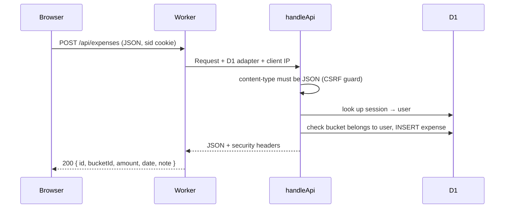
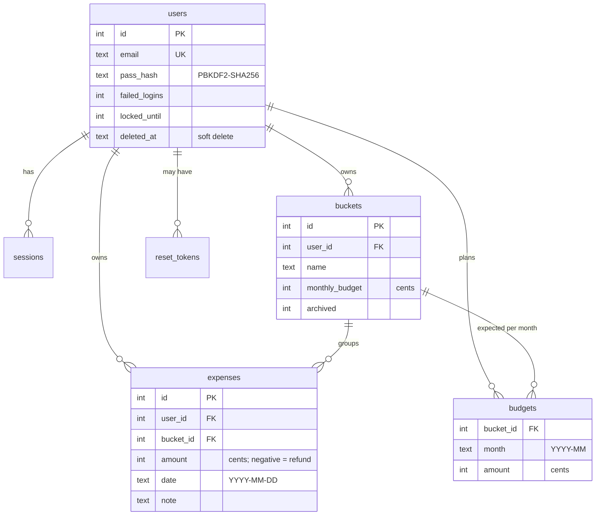
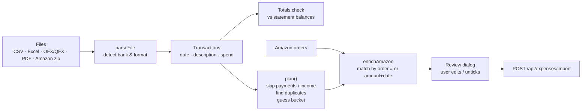
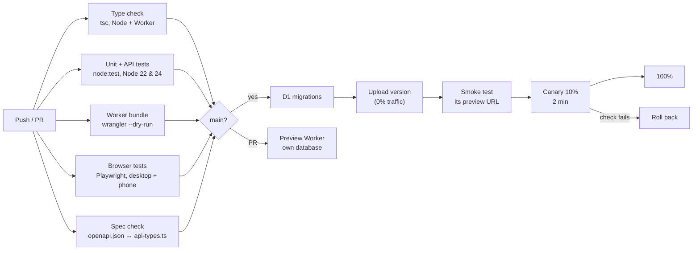

# Budgedora architecture

Budgedora is a small, multi-account expense tracker. It is built to be cheap to run (Cloudflare's free tier),
quick to use on a phone, and easy to reason about: one TypeScript API, one SQL schema, and a framework-free front end.

## System overview



The same `handleApi(request, db)` function runs in both places. It only uses web-standard `Request`, `Response`
and WebCrypto, and talks to the database through a four-method adapter:

```ts
interface Db {
  all<T>(sql, ...params): Promise<T[]>;
  get<T>(sql, ...params): Promise<T | null>;
  run(sql, ...params): Promise<{ lastId; changes }>;
  batch(stmts): Promise<unknown>;   // all-or-nothing
}
```

| Adapter | Where | File |
|---|---|---|
| D1 | Cloudflare Worker | `src/worker.ts` |
| node:sqlite | Local server and tests (in memory) | `src/sqlite-db.ts` |

Because the API is a pure function of `(Request, Db) → Response`, the tests call it directly against an in-memory
database, with no HTTP server or mocks.

## Request flow



Every query that touches user data is scoped by `user_id`. Accounts cannot see each other's rows, and the API tests check this.

## Data model



Money is stored as integer cents and converted to dollars only at the API boundary.
`login_attempts` (per-IP throttling) is a standalone table. Schema changes ship as numbered files in `src/migrations/`.

## Statement import pipeline

Bank and card statements are parsed **in the browser**. The file never leaves the device; only the
rows the user approves are sent to the API.



- **Format detection:** AMEX, Chase card and checking, and Wells Fargo are detected from their column headers, the
  headerless WF layout, or the PDF text. Any other bank's CSV or OFX works through a generic path.
- **PDFs:** pdf.js (self-hosted, because the CSP blocks third-party scripts) returns positioned text. The parser groups it
  into lines. Where a statement has separate deposit and withdrawal columns, it tells them apart by column position.
- **Safety nets:**
  - a **totals check** compares the parsed sum with the statement's own beginning and ending balances;
  - **duplicate detection** matches on date, cents and merchant, so re-importing a statement adds nothing.
- **Bucket guesses** are made in this order: the user's own history for that merchant, then merchant patterns, then the
  bank's category.

## Security

| Concern | Approach |
|---|---|
| Passwords | PBKDF2-SHA256, 100k iterations, random salt, constant-time compare; dummy hash for unknown emails |
| Brute force | Per-account lockout (5 tries, escalating up to 24 h) and per-IP limit (30 / 15 min) |
| Sessions | 256-bit random token, `HttpOnly; SameSite=Lax; Secure`, 60 days; password change revokes other sessions |
| CSRF | State-changing requests must be `application/json`, which forces a CORS preflight |
| XSS | All user text escaped on render; CSP without inline scripts or `eval` (the amount calculator is a small parser) |
| Account recovery | One-time reset links created by the family admin, stored only as a SHA-256 hash, valid for 24 h |
| Data loss | Soft-deleted accounts; D1 Time Travel; daily and monthly gzip snapshots in KV; weekly local export |

## Testing and delivery



- **Unit tests** (`test/statements.test.ts`, `test/smart.test.ts`) cover parsing, bucket guessing, duplicate detection,
  Amazon matching, plain-English questions and the calculator. They use made-up fixtures only.
- **API tests** (`test/api.test.ts`) run the real API against in-memory SQLite. They cover sign-up, lockout, throttling,
  password reset, isolation between accounts, CRUD, import and export.
- **Contract tests** (`test/contract.test.ts`) validate every API response against `public/openapi.json` with Ajv, and
  require every documented operation to be exercised. The server code is also typed against types generated from the spec.
- **Demo tests** (`test/demo.test.ts`) cover the public demo's isolation, limits and clean-up.
- **Load test** (`load/api.k6.js`, k6) runs 25 people at once against a local server. In the last run, p95 was under 10 ms for every route.
- **Browser tests** (`e2e/`) run the full flow in Chromium at desktop and phone sizes: sign up, add an expense, import an
  AMEX statement, and ask a question.

Releases: [release.md](release.md). Metrics, logs and targets: [observability.md](observability.md). Threats and controls:
[threat-model.md](threat-model.md). Design decisions and their trade-offs: [`docs/decisions/`](decisions/).
