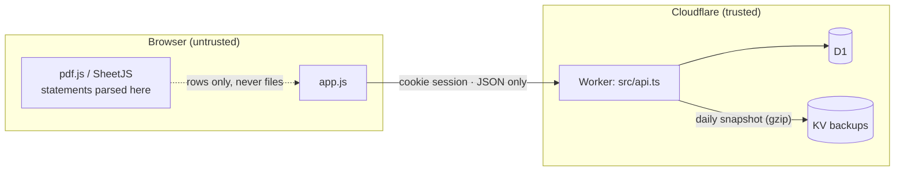

# Threat model

Budgedora holds a family's spending history. Amounts, dates, merchants and notes reveal a lot about a household.
Bank statements are read **in the browser** and only the resulting rows are sent, so statement files and account
numbers never reach the server. The main risks are:
- someone else signing in;
- one account reading another's data;
- the public demo being abused;
- a bad release or migration damaging the data.

## Assets and trust boundaries

| Asset | Where it lives | Who may read or write it |
|---|---|---|
| Expenses, buckets, month plans | D1, every row keyed by `user_id` | The account owner |
| Password hashes, sessions, reset tokens | D1 (`pass_hash` as PBKDF2; reset tokens stored only as SHA-256 hashes) | Only the Worker |
| Backups | KV, gzip JSON. Demo accounts are left out. | Account owner of the Cloudflare account |
| Admin list | `ADMIN_EMAILS` Cloudflare secret | Cloudflare account owner |

## Threats and controls (STRIDE)

| # | Threat | Control | Tested in |
|---|---|---|---|
| S1 | Password guessing | PBKDF2-SHA256 with 100k iterations. Account lockout after 5 failures (15 minutes, doubling, at most 24 hours). 30 attempts per 15 minutes per IP across all accounts. | `test/api.test.ts` |
| S2 | Finding out which emails have accounts | Unknown emails still run a full PBKDF2 hash, so timing doesn't reveal them, and the error message is the same | `api.test.ts` |
| S3 | Session theft through script | Random 256-bit session token, HttpOnly, SameSite=Lax, Secure over HTTPS. Strict CSP enforced (no inline script). | `api.test.ts`, `e2e/` |
| S4 | A stolen reset link | One use, valid 24 hours, stored only as a hash. Using it signs out every other session. | `api.test.ts` |
| T1 | Cross-site request forgery | State-changing requests must be `application/json`. That forces a CORS preflight, which the API never approves. | `api.test.ts` |
| T2 | Changing another account's expenses or buckets | Every query includes `user_id = ?` from the session. Bucket ids in requests are checked for ownership. | `api.test.ts`, `test/demo.test.ts` |
| T3 | A bad deploy or migration breaks or corrupts data | Migrations are additive only. Each new version is smoke-tested at its own URL before getting traffic, then a 10% canary, with automatic rollback. Daily and monthly KV snapshots, with a restore script. | `scripts/release.ts`, `docs/release.md` |
| R1 | "I didn't delete that account" | Deletion is soft: the data is kept and only the family admin can restore it | `api.test.ts` |
| I1 | One account reading another's data | `user_id` scoping on every read. The contract tests check responses expose only documented fields (`additionalProperties: false`). | `api.test.ts`, `test/contract.test.ts` |
| I2 | Statement files leaking | Parsed in the browser with self-hosted pdf.js. Only date, amount, bucket and note are sent. | `test/statements.test.ts` |
| I3 | Demo visitors seeing real data, or each other's | Each visitor gets a separate new account. Demo accounts can't sign in by password, change their password, delete themselves or be admins. They're excluded from backups and the admin list, and deleted after 24 hours. | `test/demo.test.ts` |
| D1 | Using the demo to burn the free D1 quota | 10 demos per IP per day and 100 overall. Each demo is created in 2 statements (rows expanded with `json_each`), so it stays inside the per-request query limit. | `test/demo.test.ts` |
| D2 | Huge imports | Request body is limited to 5 MB and 20,000 rows, inserted in batches of 400 | `api.test.ts` |
| E1 | A user acting as admin | Admins are listed in a secret, checked on every admin route, never for demo accounts | `api.test.ts`, `demo.test.ts` |

## Browser hardening

Every response, including pages, carries an **enforced** CSP:
- scripts only from the app, plus Chart.js and SheetJS pinned to exact versions on their CDNs;
- `connect-src 'self'`;
- `object-src 'none'`;
- `frame-ancestors 'none'`.

Every response also carries HSTS, `nosniff`, `Referrer-Policy: no-referrer`, a strict `Permissions-Policy`, and COOP/CORP
(`SECURITY_HEADERS` in `src/api.ts`).

## Known gaps

- **Email is not verified at sign-up.** It's a family app, and the admin resets passwords by hand.
- **CDN scripts have no Subresource Integrity hashes.** The two CDN scripts are pinned by exact version in the CSP.
- **Rate limits live in D1** (`login_attempts`), not at the edge. Cloudflare's rate-limiting rules would stop floods earlier.
